# ZCode Pocket

**English** | [简体中文](README.zh-CN.md)

A native Android client (Flutter) for the ZCode desktop app. It brings
multi-computer management, the task home, streaming conversations, approval
interactions, branch selection, usage stats and more to your phone, keeping
interaction habits consistent with the desktop. It connects to ZCode's
official Web Remote Control channel (relay + V4 protocol); you need your own
ZCode account and a running desktop.

> **Unofficial project disclaimer**: This is a community-driven third-party
> client. It is not affiliated with, authorized by, or endorsed by
> ZCode / Zhipu. The ZCode name belongs to its owner. Protocol behavior is
> implemented against the official open-source implementation; no official
> runtime code is included. UI strings are generated from the official
> open-source localization resources (Apache 2.0; see third-party notices).
>
> **Service usage notice**: This repository contains client code only. When
> using it with the official ZCode service you must comply with the official
> terms of service (zcode.z.ai/cn/terms) — the current terms default to
> non-commercial personal research and study; commercial use requires a
> separate agreement with the provider.

## Screenshots

> All content shown (accounts, projects, conversations) is demo data produced
> by the built-in demo mode — no real usage records.

**Demo video** (26s: streaming output → tool calls → permission approval → done)

https://github.com/user-attachments/assets/4e81ba59-6d69-4316-a5fc-67955c261c47

**Light**

| Task home | Conversation: streaming and tool calls |
|---|---|
| 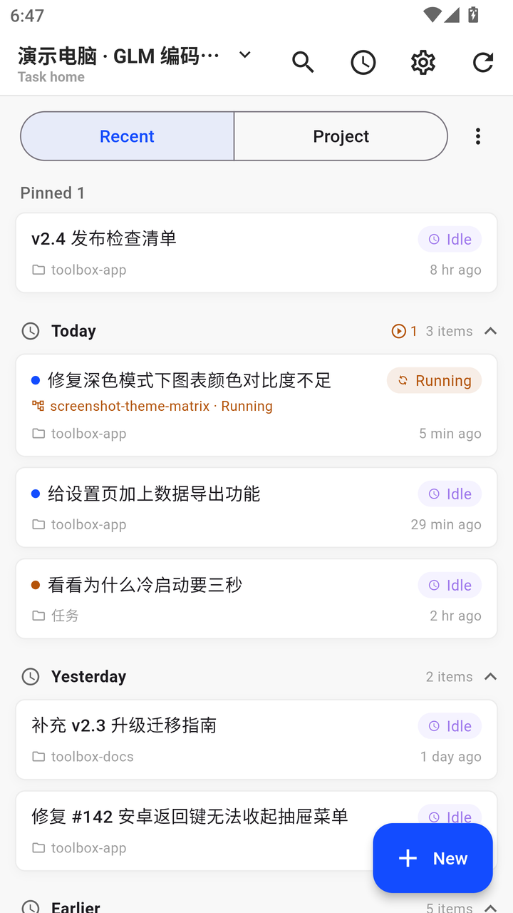 | 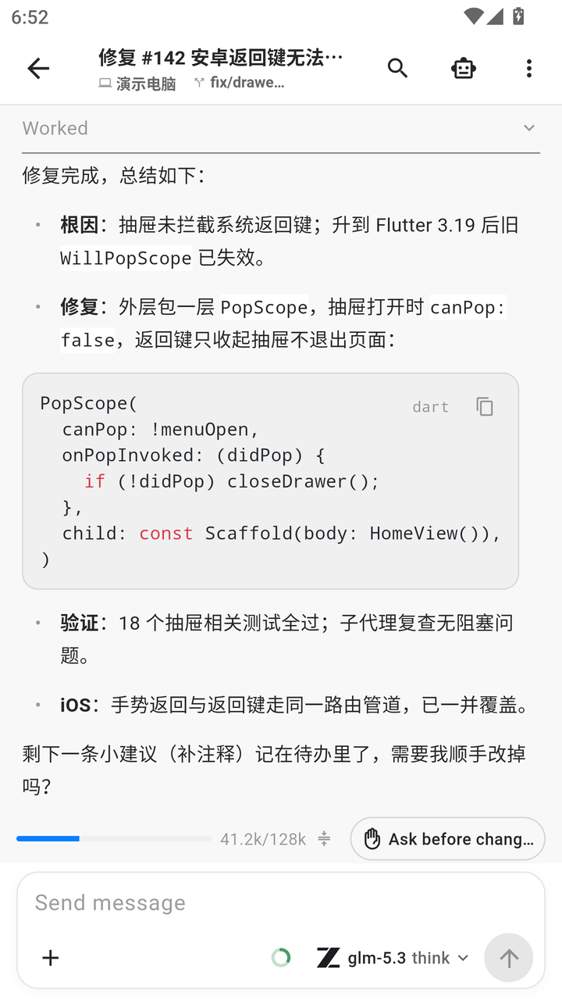 |
| **Approval interaction (Bash permission)** | **Model & thinking level** |
| 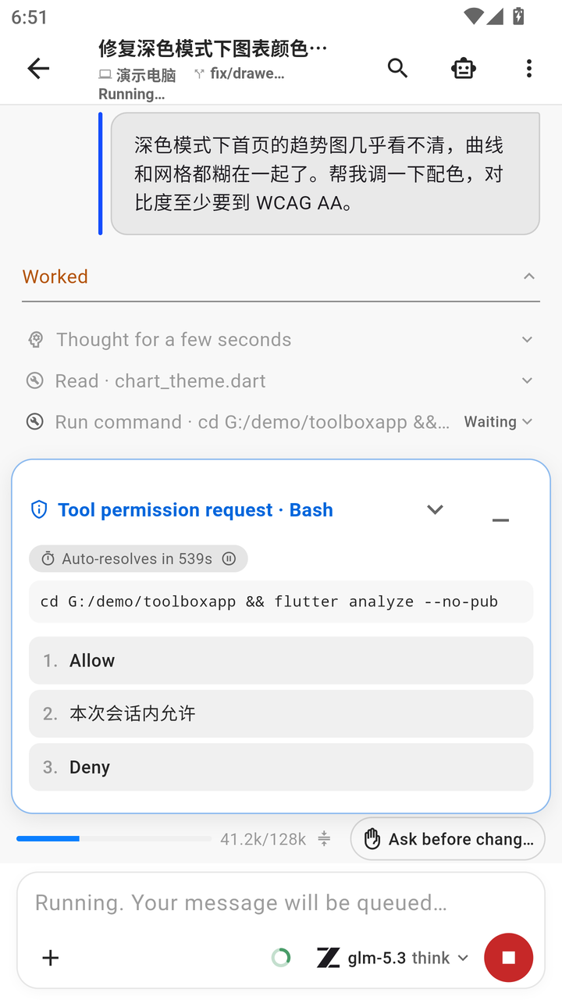 | 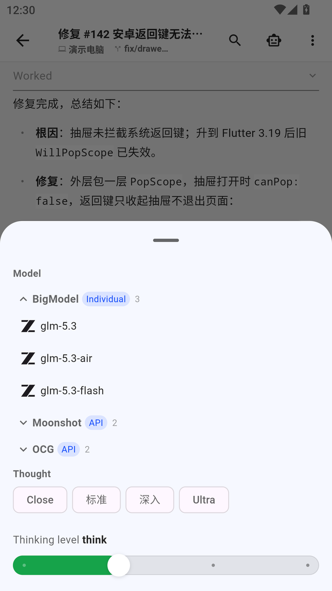 |
| **Usage stats (heatmap / trends / quota)** | **Workflow runs and artifacts** |
| 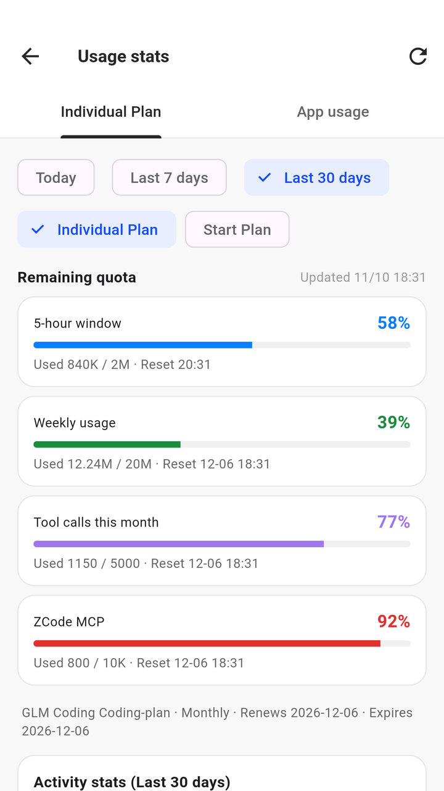 | 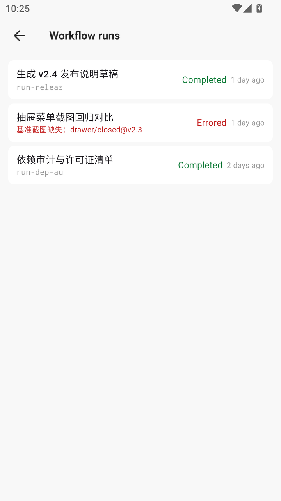 |

**Dark**

| Task home | Conversation: streaming and tool calls |
|---|---|
| 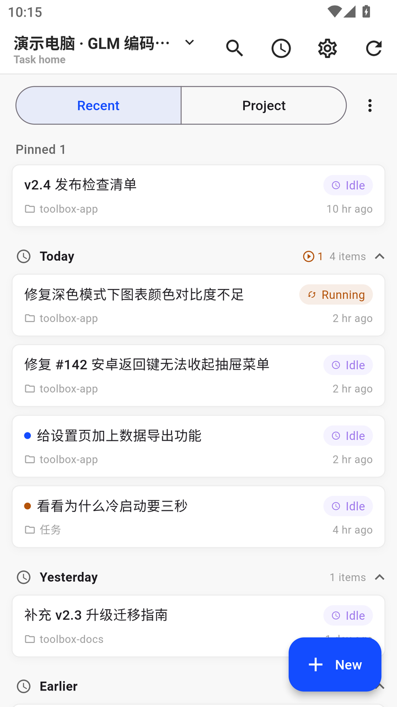 | 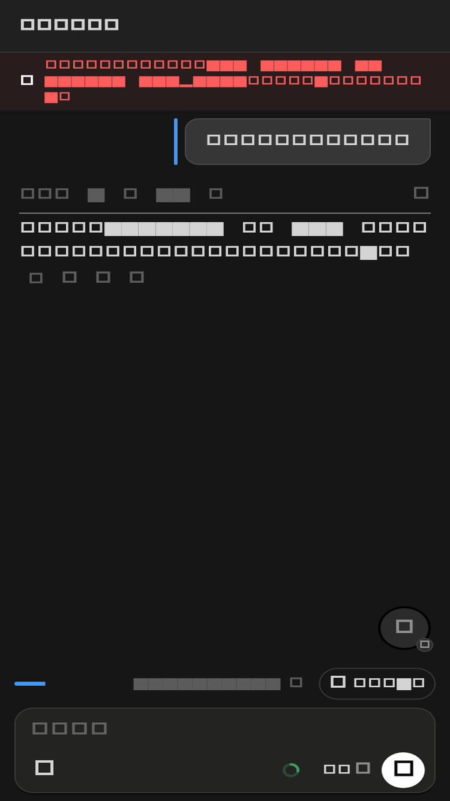 |
| **Approval interaction (Bash permission)** | **Usage stats** |
| 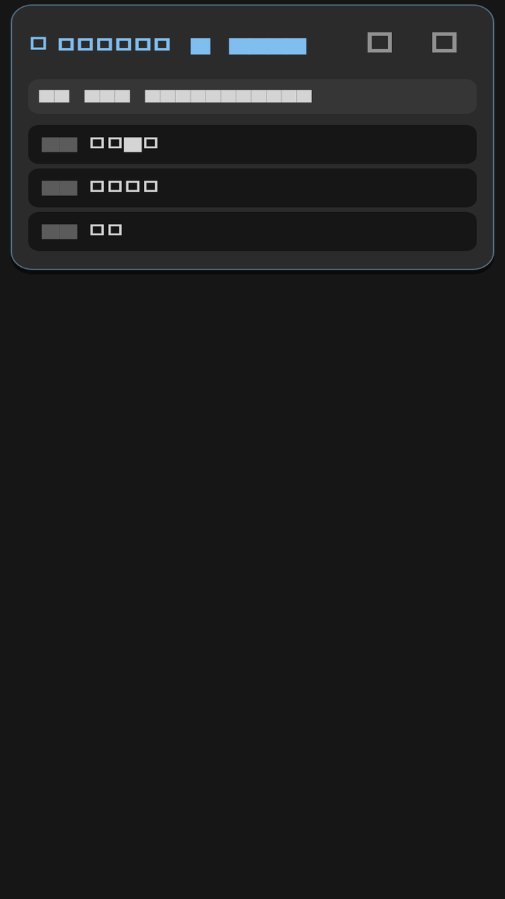 | 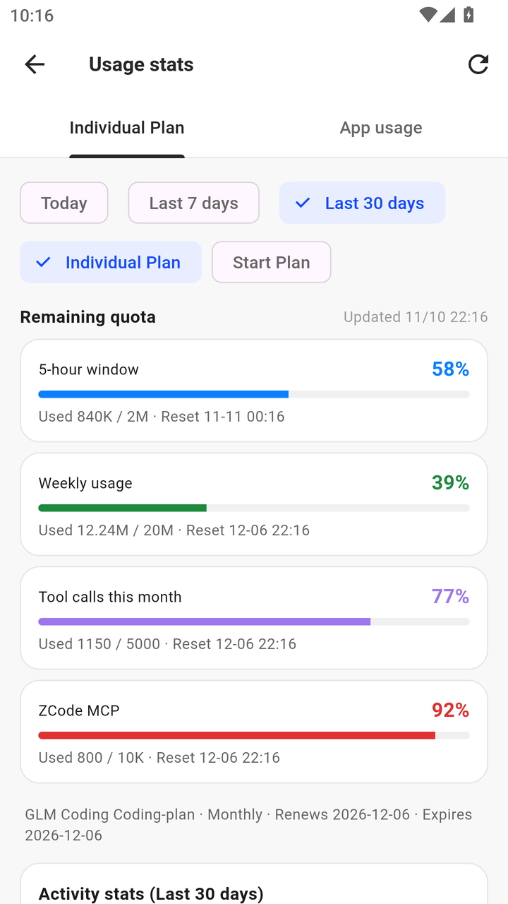 |

**Foldable unfolded / wide-screen dual pane** (task list + conversation)

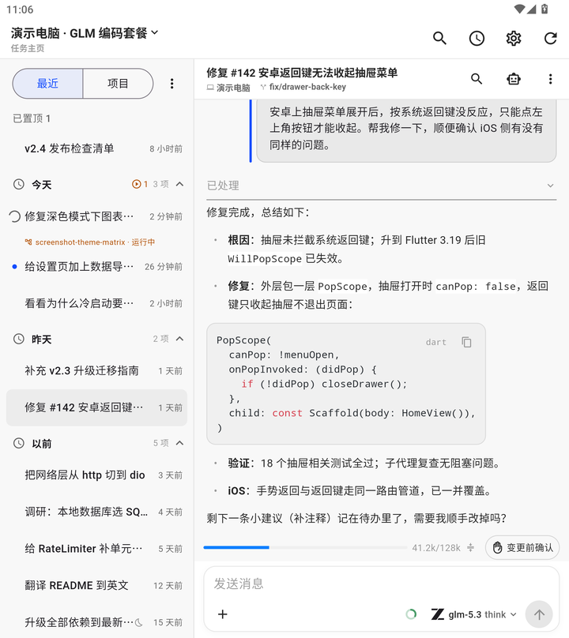

## Features

- Multi-computer / multi-account management (parallel online, isolated
  profiles, computer nicknames, read-only task snapshots of other computers)
- Task home: all tasks grouped by time/project, project ordering, pin,
  archive, batch actions
- Conversations: streaming output, tool-call display, approvals, subagent
  list & drill-down, context compaction, in-conversation full-text search,
  notification deep links
- Projects / branches: workspace project tree, branch picker for new chats
- Input: persistent drafts (isolated per computer/account/workspace/
  conversation), offline send queue, attachments, screenshot annotation,
  voice input (system recognizer)
- Workflows: run catalog and artifact viewing (text/HTML preview)
- Usage: subscription usage, heatmap (total / per-model), daily and
  per-model breakdowns and trends
- Appearance: light/dark themes, Chinese/English UI, foldable-unfolded and
  wide-screen dual pane, font scaling
- About page: unofficial disclaimer, service-terms notice, privacy notes,
  project license and third-party notices (bundled offline)

## Requirements

- Android 7.0+ (minSdk 24; arm64 / armv7 / x86_64, arm64 recommended)
- A ZCode account you can sign in with, and a running desktop (or cloud
  session)
- Logical screen width 320dp–840dp (portrait is the only main orientation)

Desktop compatibility (pairing uses the account-based channel, which needs
desktop **3.16+**):

| Desktop version | Status |
|---|---|
| 3.18.0 (not yet released by ZCode) | Assessed against official sources: zero breaking changes, no adaptation needed; on-device verification pending after release |
| 3.17.x (current) | Verified on 3.17.1 on-device; 3.17.2 reviewed against official sources |
| 3.16 – 3.16.3 | Verified end-to-end (pairing, tasks, conversations) |
| 3.15.x | Legacy QR pairing only (old channel; no longer exercised by the maintainer) |
| 3.14 and earlier | Untested |

The protocol is additive by design: unknown message types and fields are
ignored rather than rejected, so a newer desktop usually keeps working — but
verify after major desktop upgrades before filing a protocol bug.

## Installation

Grab a prebuilt APK from [Releases](https://github.com/JZYLukis/zcode-pocket/releases)
(most phones: `arm64-v8a`) — or build from source below. Before mixing the two,
read [Signing and switching builds](#signing-and-switching-builds): the
signatures differ and switching requires uninstalling, which erases local data.
Per-version changes and upgrade notes are in [CHANGELOG.md](CHANGELOG.md).

## Verifying downloads

You don't have to trust the APKs — you can verify them:

1. **Signature**. All prebuilt APKs are signed with the same release key:

   ```
   Certificate SHA-256: 2e079b31d61d3f6fbbc5aa4fc9ed0cb0d2787b4de7e558345b630a59c546b681
   ```

   This fingerprint will not change across versions (changing it would break
   updates for every installed user; if it ever must, the change will be
   announced in a release). Verify with:

   ```bash
   apksigner verify --print-certs app-arm64-v8a-release.apk
   ```

2. **Checksums**. Recent releases (v1.0.2 onward) list the SHA-256 of every
   APK in their CHANGELOG.md "Checksums" section. Verify with
   `sha256sum <apk>`.

3. **Provenance**. Each release is built from this repository at the release
   tag (recorded in the release notes). When present, the APK's `versionName`
   embeds the commit it was actually built from — e.g. v1.0.0 is
   `1.0.0-7fe66058e900`; check it with `aapt dump badging <apk> | head -1`.
   CI builds the same tree on every push (analyze + tests + debug and
   release compile), so the released source is continuously
   machine-verified. Self-built APKs are debug-signed unless you configure
   your own keystore (see below), so their signature will differ by design.

## Build

```bash
flutter pub get
flutter build apk --split-per-abi
```

Without `app/android/key.properties`, release builds fall back to debug
signing (fine for personal use); configure your own signing for wider
distribution.

### Signing and switching builds

The prebuilt APKs are signed with the maintainer's release keystore. A build
made from this repository without `app/android/key.properties` uses the
Android debug keystore instead, so the two have **different signatures**.

Android refuses to update an installed app with an APK signed by a different
key (`INSTALL_FAILED_UPDATE_INCOMPATIBLE`). To switch between the prebuilt APK
and your own build you must uninstall the old app first. **Uninstalling erases
local data** — signed-in accounts, paired computers, drafts, the offline send
queue — and there is no cloud backup (`allowBackup=false`).

To keep receiving updates without uninstalling, always build with the same
keystore and keep using that build. Fill four keys in
`app/android/key.properties` (values from your own keystore):

| Key | Meaning |
|---|---|
| `storeFile` | keystore path (relative paths resolve inside `app/android/app/`) |
| `storePassword` | keystore password |
| `keyAlias` | key alias |
| `keyPassword` | key password |

Do not commit the keystore or this file; the repository `.gitignore` already
excludes them.

### Voice input

Speech recognition uses the standard system service (Android
SpeechRecognizer) — no keys or extra setup required. Devices with a
recognition service work out of the box; the entry hides itself when none is
available. Optional transcript polishing supports Zhipu / DeepSeek / Kimi
with your own API keys in settings.

## Background & battery

- The app disconnects about 90 seconds after backgrounding (by design) and
  reconnects automatically on return.
- With the "approval alerts" switch enabled it stays connected in the
  background for real-time alerts, with correspondingly higher battery use.
  For stable background behavior on vendor ROMs, allow
  **auto-launch / associated launch / background activity** for this app in
  system settings (location varies by vendor, usually under battery or
  startup management).

## Privacy

- No telemetry, no third-party analytics, no ads. Conversation and task data
  go only to the ZCode desktop / official service you configure.
- Account credentials are stored in the Android keystore; Android backup is
  disabled (`allowBackup=false`), so app data is not copied into cloud
  backups.
- **Lock screen**: by default Android may show notification content on the
  lock screen. ZCode Pocket notifications contain the task title and up to
  60 characters of the latest assistant reply; the optional foreground
  connection notification also shows the name of the running task. To hide
  this, enable "hide sensitive notification content" (or disable lock-screen
  notifications) for ZCode Pocket in system settings.
- **Local caches are plain JSON**: task and usage snapshots, conversation
  caches and the notification ledger live as plain JSON inside the app's
  private storage (never in cloud backups, and not readable by other apps on
  a non-rooted device). You can clear them anytime from
  Settings → About → "Clear local cache"; drafts, queued messages, accounts
  and settings are not affected.

## Known limitations

Each of these is also tracked as a `known-limitation` issue with its current
status and workaround.

- Portrait is the only main orientation; wide screens and foldables unfolded
  (≥600dp) use a dual-pane layout (task list + conversation); the
  large-tablet layout is still being polished.
- No built-in image/PDF preview — the remote-control protocol has no
  file-byte channel; only newly created HTML files can be previewed. View
  other files on the desktop.
- QR pairing shows a static viewfinder instead of a live camera preview
  (a renderer workaround for some devices), and the screen rebuilds once
  after a successful pairing.
- The app disconnects about 90 seconds after backgrounding (battery by
  design); you don't get real-time task-completion notifications in the
  background unless "approval alerts" is enabled.
- "Approval alerts" keeps a background connection for real-time alerts, with
  correspondingly higher battery use.
- Off-peak (idle-time) tasks cannot be edited from the phone — the remote
  protocol only exposes create/list; edit them on the desktop.
- One terminal per desktop: connecting a second phone/account to the same
  desktop kicks the previous connection (different desktops run in parallel
  fine); time-share one desktop by switching accounts.
- The prebuilt APK and your own build have different signatures; switching
  between them requires uninstalling, which erases local data (no cloud
  backup).
- Not applicable to HarmonyOS NEXT (Android APK).
- Verified mainly on mainstream Android and foldable devices; other devices
  are welcome to open issues.

## Maintenance

Maintained by [@JZYLukis](https://github.com/JZYLukis) — a solo maintainer,
best effort. The primary target is the desktop version the maintainer
currently runs; other desktop versions are supported on a best-effort basis.
Key design trade-offs and their costs are recorded in
[docs/decisions.md](docs/decisions.md) — check it before reporting something
that might be intended behavior. See [CHANGELOG.md](CHANGELOG.md) for release
notes. Please open an issue for problems and feedback.

## License

Apache License 2.0 (see LICENSE). Transport-layer modules under
`app/lib/transport/` were initially ported from
[zemote](https://github.com/HumanAILoop/zemote) (MIT) and have since been
rewritten and hardened against the official open-source implementation — see
[THIRD-PARTY-NOTICES.md](THIRD-PARTY-NOTICES.md) for the attribution details
and the full MIT text.
