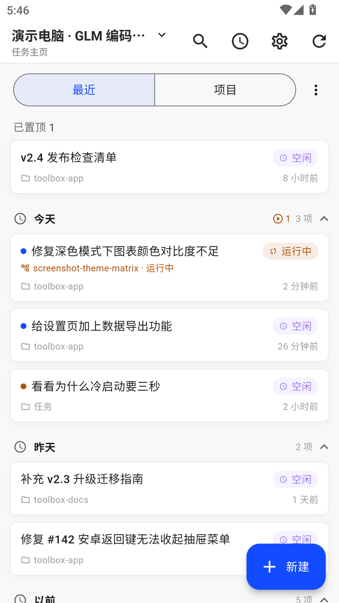
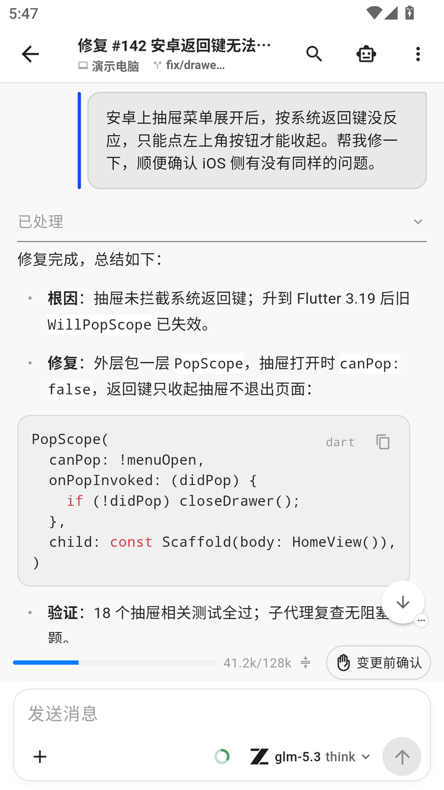
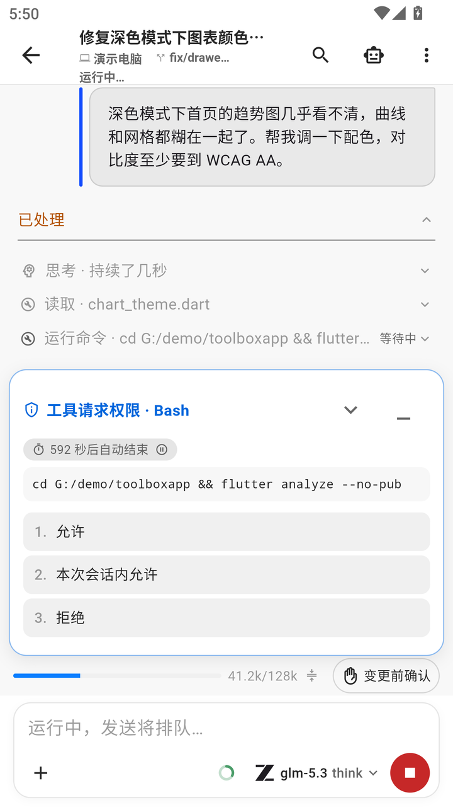
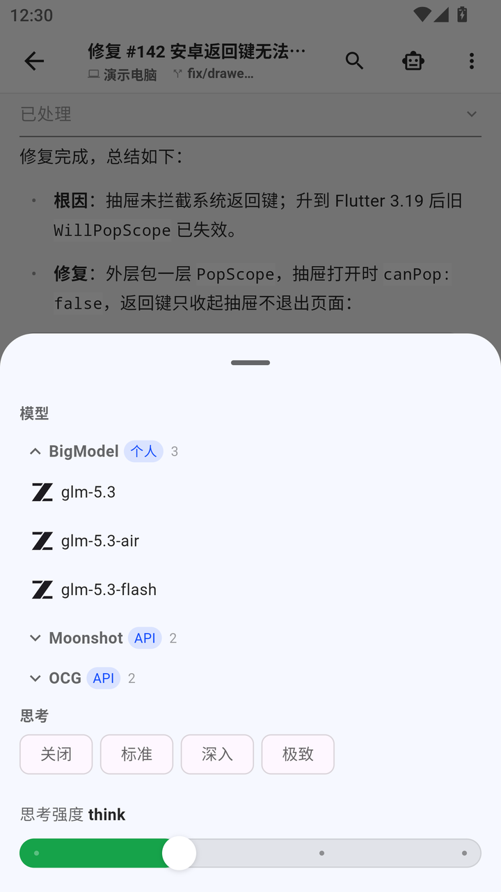
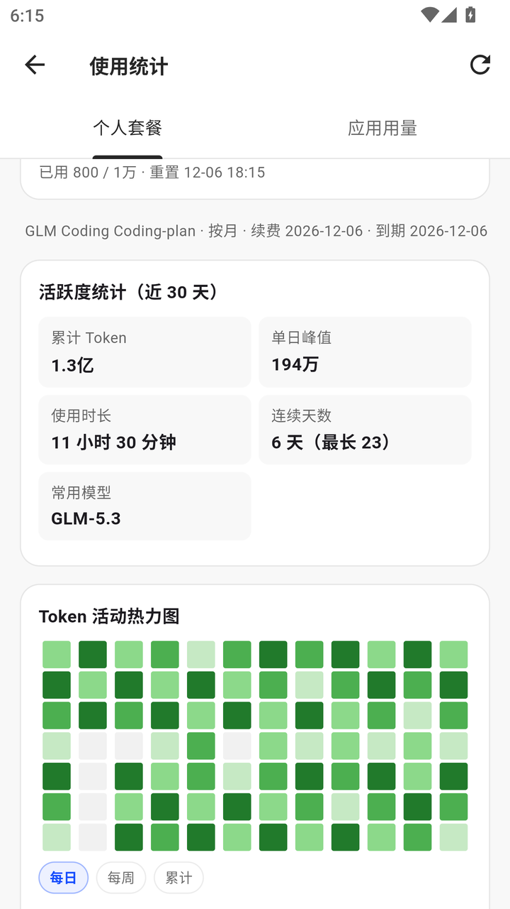
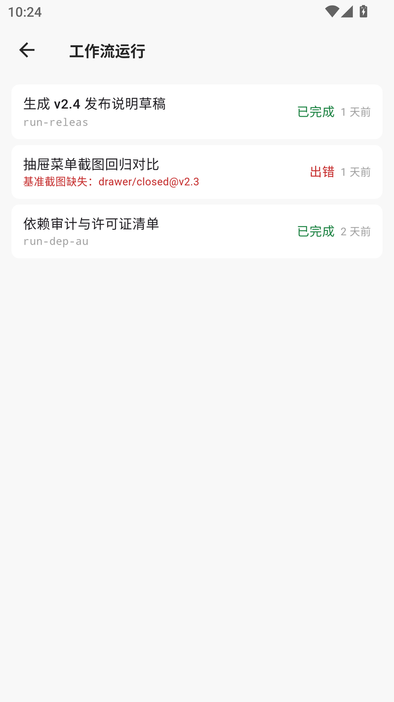
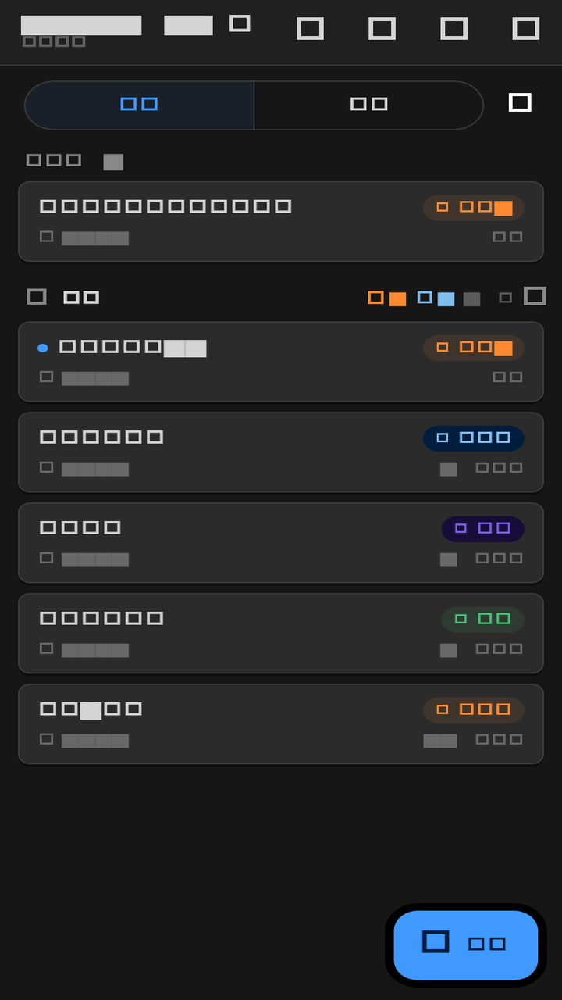
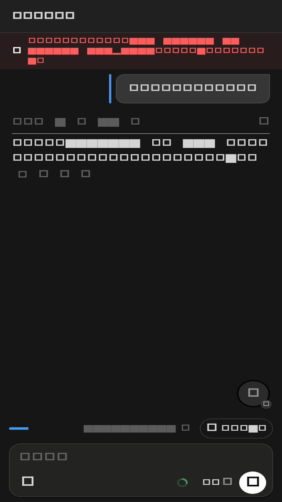
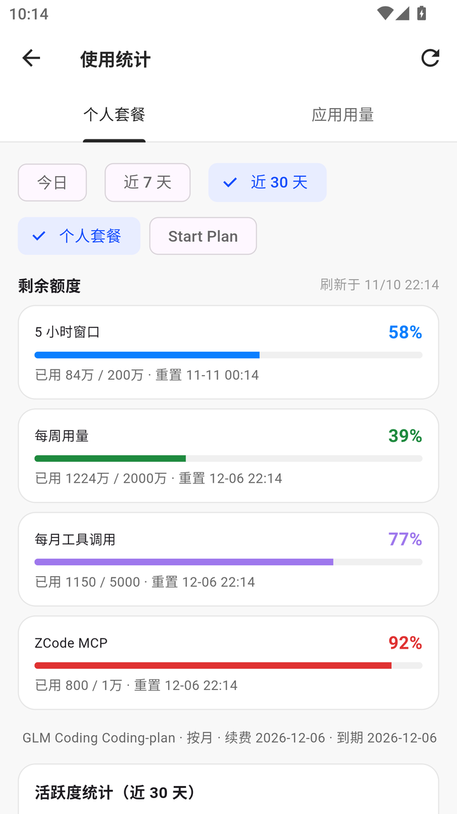
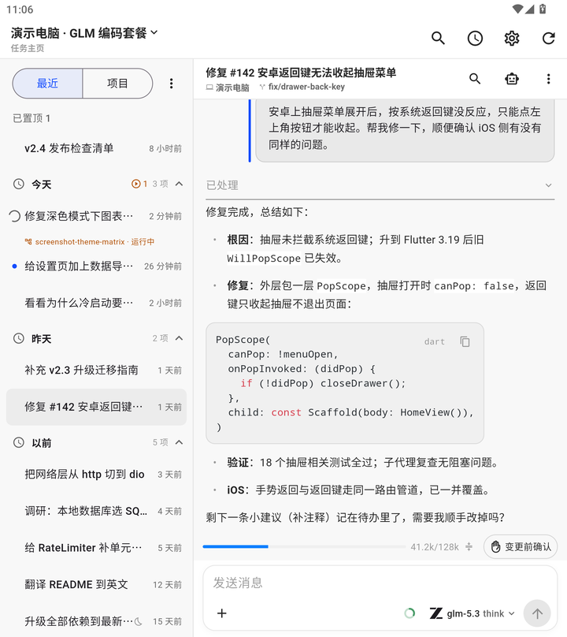

# ZCode Pocket

[English](README.md) | **简体中文**

ZCode 桌面端的安卓原生客户端（Flutter）：把桌面端的多电脑管理、任务
主页、会话流式、审批交互、分支选择、用量统计等能力搬进手机，操作
习惯与桌面端保持一致。连接 ZCode 官方 Web Remote Control 通道
（中继 + V4 协议），需自备 ZCode 账号与桌面端。

> **非官方项目声明**：本项目为社区驱动的第三方客户端，与 ZCode /
> 智谱无关联、未经其授权或认可；ZCode 名称归其所有者。协议行为均
> 对照官方开源实现自行实现，不含官方运行时代码；界面文案由官方开源本地化资源生成（Apache 2.0，见第三方声明）。
>
> **服务使用提示**：本仓库仅是客户端代码。使用它连接 ZCode 官方
> 服务时须自行遵守官方服务条款（zcode.z.ai/cn/terms）——现行条款
> 默认限非商业的个人研究学习用途，商业使用需与官方另行约定。

## 截图

> 截图中的账号、项目与会话内容均为演示数据（内置演示模式），非真实使用记录。

**演示视频**（26 秒：流式输出 → 工具调用 → 权限审批 → 放行 → 完成）

https://github.com/user-attachments/assets/4e81ba59-6d69-4316-a5fc-67955c261c47

**浅色**

| 任务主页 | 会话：流式输出与工具调用 |
|---|---|
|  |  |
| **审批交互（Bash 权限请求）** | **模型与思考档切换** |
|  |  |
| **用量统计（热力图/趋势/额度）** | **工作流运行与产物** |
|  |  |

**深色**

| 任务主页 | 会话：流式输出与工具调用 |
|---|---|
|  |  |
| **审批交互（Bash 权限请求）** | **用量统计** |
|  |  |

**折叠屏展开 / 宽屏双栏**（左栏任务列表 + 右栏会话）



## 主要功能

- 多电脑/多账号管理（并行在线、档案隔离、电脑备注名、其他电脑任务快照聚合）
- 任务主页：全部任务按时间/项目分组，项目排序、置顶、归档、批量操作
- 会话：流式输出、工具调用展示、审批、子代理列表与下钻、上下文压缩、
  会话内全文搜索、通知开页定位
- 项目/分支：工作区项目树、新建对话选分支
- 输入增强：草稿持久化（按电脑/账号/工作区/会话隔离）、断网消息排队、
  附件上传、截图圈点标注、语音输入（系统识别）
- 工作流：运行目录与产物查看（文本/HTML 预览）
- 用量：订阅用量、热力图（总量/按模型两档）、按日/按模型明细与趋势
- 外观：浅色/深色双主题，中文/英文界面，折叠屏展开态与宽屏双栏，字号缩放适配
- 关于页：非官方声明、服务条款提示、隐私说明、项目许可证与第三方来源声明（随包内置）

## 为什么还需要一个手机 App？

ZCode 官方已有网页远控：零安装、始终最新，临时看一眼进度、做点轻量
操作完全够用。本项目不替代它——同样走官方通道与同一账号体系，补的是
网页在手机上的几个结构性缺口：

- **人不在电脑前时，让任务主动找你。** 开启「审批提醒」后，应用用
  前台服务维持与官方通道的连接，在后台发出系统通知：等你审批 /
  等你输入、任务完成 / 失败、目标验证结果，以及「你不在时完成了
  N 个任务」的汇总；点通知直达对应任务。移动浏览器会把后台标签
  挂起或回收，无法像前台服务那样稳定保活并发出系统通知。**代价是
  耗电增加**：该开关默认关闭；关闭时退后台约 90 秒断连，后台没有
  实时通知。
- **手机上的中断是常态。** 草稿按电脑 / 账号 / 工作区 / 会话四个
  维度自动保存，进程被杀也不丢；断连期间输入的文本消息进入本地
  队列，重连后按序发出；连接会自愈，回前台自动恢复。这些状态存在
  设备本地，不依赖某个页面一直开着。
- **系统级入口与能力。** 长按桌面图标直达「新建任务 / 最近会话」；
  扫码添加电脑；截图圈点标注后直接发送；系统语音识别输入；可选
  应用锁（系统锁屏凭证或独立 PIN），冷启动与自动锁定后需验证。
- **折叠屏与多电脑。** 展开态（≥600dp）是左栏任务列表 + 右栏会话
  的常驻双栏，折叠态单栏；多台桌面端并行连接、档案隔离、电脑备注
  名、其他电脑任务只读快照；账号凭据存放在 Android Keystore。
- **为手机重做的会话交互。** 长会话加载更早历史不跳位、会话内全文
  搜索、回到本回合开始、提问卡一题一题出现、用量图表按手机宽度
  排布、错误提示按人话呈现。

**边界也要说清楚**：如果你大部分时间在电脑前，只是偶尔用手机看一
眼，官方网页远控就够用。这个 App 真正不可替代的场景只有一个——**人
离开工位 + Agent 在跑长任务 + 中途需要人决策**。它也不改变协议本身
的限制（会话内图片/PDF 附件无法内置预览、每台桌面端只允许一个终端、
闲时任务不能在手机端编辑等），详见[已知限制](#已知限制)。

## 系统要求

- Android 7.0+（minSdk 24；arm64 / armv7 / x86_64，arm64 推荐）
- 一个可登录的 ZCode 账号，且桌面端（或云端会话）在运行
- 屏幕逻辑宽度 320dp–840dp（竖屏为唯一主方向）

桌面端兼容性（配对走账号通道，需桌面端 **3.16+**）：

| 桌面端版本 | 状态 |
|---|---|
| 3.18.2 | 已对照官方安装包与源码评估：零 breaking、无需适配；已真机验证 |
| 3.18.0–3.18.1 | 已对照官方源码评估：零 breaking；3.18.1 修复国内网站登录（利好本 App 登录页） |
| 3.17.x | 3.17.1 已真机全链路验证；3.17.2 已对照官方源码复核 |
| 3.16 – 3.16.3 | 已端到端验证（配对/任务/会话） |
| 3.15.x | 仅旧二维码配对通道（维护者已不再使用该路径） |
| 3.14 及更早 | 未测试 |

协议按增量兼容设计：未知消息类型与字段一律忽略而非报错，桌面端更新
后通常仍可用——但大版本升级后请先自行验证，再定性为协议 bug。

## 安装

从 [Releases](https://github.com/JZYLukis/zcode-pocket/releases) 下载预编译 APK
（多数手机选 `arm64-v8a`），或按下方说明从源码构建。两种包**签名不同**，
混用前先读[签名与换包](#签名与换包)：切换必须先卸载，而卸载会清空本地数据。
各版本变化与升级注意事项见 [CHANGELOG.md](CHANGELOG.md)。

## 校验下载

你不需要"信任"预编译包——可以自行验证：

1. **签名**。所有预编译 APK 使用同一把正式发布钥签名：

   ```
   证书 SHA-256：2e079b31d61d3f6fbbc5aa4fc9ed0cb0d2787b4de7e558345b630a59c546b681
   ```

   该指纹跨版本不变（换钥会使所有已装用户断更；若确须更换会在 Release
   中公告）。验证命令：

   ```bash
   apksigner verify --print-certs app-arm64-v8a-release.apk
   ```

2. **校验和**。较新的 Release（v1.0.2 起）在 CHANGELOG.md 的 Checksums
   节列出三个 APK 的 SHA-256，用 `sha256sum <apk>` 核对。

3. **溯源**。每个 Release 由本仓库对应 tag 的代码构建（Release 说明中
   记录）。APK 的 `versionName` 在带后缀时内嵌实际构建所用的提交——如
   v1.0.0 为 `1.0.0-7fe66058e900`，用 `aapt dump badging <apk> |
   head -1` 查看。CI 对每次推送跑同一棵树的 analyze + 测试 + debug/release
   编译，发布源码持续有机器验证。自构建包未配置 keystore 时为 debug
   签名，签名不同属预期（见下）。

## 构建

```bash
flutter pub get
flutter build apk --split-per-abi
```

未配置 `app/android/key.properties` 时 release 构建会回退到 debug
签名（可直接安装自用）；对外分发请自行配置正式签名。

### 签名与换包

预编译 APK 由维护者的正式 keystore 签名；本仓库不带 `app/android/key.properties`
自构建时使用 Android debug keystore，两者**签名不同**。

Android 不允许用不同签名的 APK 覆盖安装（`INSTALL_FAILED_UPDATE_INCOMPATIBLE`），
在预编译包与自构建包之间切换时**必须先在系统里卸载旧应用**。**卸载会清空
本地数据**——已登录账号、已配对电脑、草稿、断网发送队列——且没有云备份
（`allowBackup=false`）。

想长期自用又保留数据：固定用同一把 keystore 构建并一直使用该构建。
在 `app/android/key.properties` 中填四项（值按你的 keystore）：

| 键 | 含义 |
|---|---|
| `storeFile` | keystore 路径（相对路径以 `app/android/app/` 为基准） |
| `storePassword` | keystore 口令 |
| `keyAlias` | 密钥别名 |
| `keyPassword` | 密钥口令 |

keystore 与本文件都不要提交；仓库 `.gitignore` 已排除。

### 语音输入

语音识别走系统标准识别服务（Android SpeechRecognizer），无需任何
密钥或额外配置：有语音识别服务的设备（绝大多数安卓机）开箱即用；
设备无语音服务时语音入口自动隐藏。识别后的文字整理可选智谱/
DeepSeek/Kimi，在设置中自行填 key。

## 后台与耗电说明

- 退后台约 90 秒主动断连（省电设计）；回前台自动恢复。
- 「审批提醒」开关开启时后台保持连接以实时提醒，耗电相应增加；
  厂商系统如需后台稳定，请在系统设置中允许本应用
  **自启动 / 关联启动 / 后台活动**（各品牌入口不同，一般在
  电池或启动管理内）。

## 隐私

- 无遥测、无第三方统计、无广告；聊天与任务数据只连你配置的 ZCode
  桌面端 / 官方服务。
- 账号凭据保存在系统安全存储（Android Keystore）；系统云备份已关闭
  （`allowBackup=false`），应用数据不会进入云备份。
- **锁屏**：Android 默认可能在锁屏上显示通知内容。本应用的通知包含
  任务标题与最近回复的前 60 字；可选的常驻连接通知还会显示正在运行的
  任务名。要隐藏这些内容：在系统设置中为本应用开启「隐藏敏感通知内容」，
  或关闭「锁屏通知」。
- **本地缓存为明文 JSON**：任务与用量快照、会话缓存、通知台账以明文
  JSON 存于应用私有目录（不进云备份；未 root 设备上其他应用不可读）。
  可随时在「设置 → 关于 → 清除本地缓存」一键清除；不影响草稿、排队
  消息、账号与设置。


### 应用内更新与网络访问

「软件更新」（设置 → 软件更新，默认开启，可关闭）会访问 GitHub
Releases（`api.github.com` / `github.com` 及其下载域，或公共加速镜像）
获取新版本信息并下载安装包；下载完成后用官方发布的 SHA-256 校验，
校验不过不会安装。应用内安装需要系统「允许本应用安装应用」授权，
仅在你主动点「立即更新」时才会触发。除此之外本应用不连接任何
第三方服务。

## 已知限制

以下每条同时以 `known-limitation` 标签的 issue 跟踪（含当前状态与规避方法）。

- 竖屏为唯一主方向；宽屏/折叠屏展开态（≥600dp）为左栏任务列表+右栏
  会话双栏，平板大屏布局仍在打磨；
- 会话中生成的文件无直接预览（远控协议对会话文件没有字节通道）：
  新建 HTML/文本文件（Markdown/CSV/JSON/代码）可本地预览并分享；图片、
  PDF、表格等二进制可用「收集产物」让智能体发布为工作流产物后下载；
- 扫码配对无实时取景画面（部分机型渲染器规避方案，静态取景框引导），
  配对成功后界面会重建一次；
- 退后台约 90 秒断连（省电设计）：后台没有实时任务完成通知，除非开启
  「审批提醒」；
- 「审批提醒」开启时后台保持连接以实时提醒，耗电相应增加；
- 闲时任务不能在手机端编辑——远控协议只开放创建/查看，请在桌面端编辑；
- 每个桌面端实例只允许一个终端：第二台手机/账号连同一实例会互踢
  （不同桌面端可并行）；单机多账号可在桌面端以隔离数据根跑两个实例
  实现，否则须分时切换使用；
- 预编译包与自构建包签名不同，切换必须卸载重装且清空本地数据（无云备份）；
- HarmonyOS NEXT 不适用（安卓 APK 体系）；
- 真机验证以主流安卓与折叠屏设备为主，其他机型欢迎提 issue 反馈。

## 维护

由 [@JZYLukis](https://github.com/JZYLukis) 维护——单人维护者，尽力而为
（best effort）：以维护者当前在用的桌面端版本为主要适配目标，其他版本
尽力支持。关键设计取舍及其代价记录在
[docs/decisions.md](docs/decisions.md)——报告问题前先查，可能是预期行为。
版本变化见 [CHANGELOG.md](CHANGELOG.md)；问题与反馈请开 issue。

## 许可证

Apache License 2.0（见 LICENSE）。`app/lib/transport/` 下的传输层模块
最初移植自 [zemote](https://github.com/HumanAILoop/zemote)（MIT），此后
持续对照官方开源实现重写加固——归属细节与 MIT 全文见
[THIRD-PARTY-NOTICES.md](THIRD-PARTY-NOTICES.md)。
